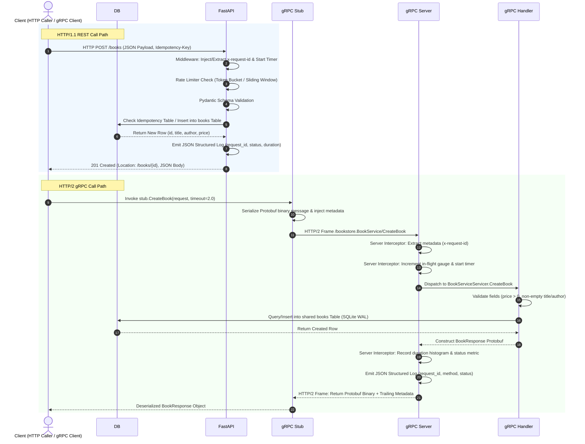

# Enterprise Software Development — Assignment 2 Report
**Course:** Enterprise Software Development, Fall 2026  
**Topic:** HTTP APIs, gRPC Services, and Dual-Protocol Metrics Observability  

---

## 1. Part A: Improve the HTTP API

### 1.1 The Six REST Constraints

The table below outlines the six fundamental architectural constraints of REST, their plain-language meanings, and concrete examples from our Bookstore API implementation.

| REST Constraint | Plain-Language Meaning | Demonstration in Bookstore API |
| :--- | :--- | :--- |
| **1. Client-Server Architecture** | Separation of user interface and client concerns from data storage and server concerns. Clients and servers evolve independently as long as the interface contract is preserved. | Demonstrated: The Python caller (`caller_http.py`) and traffic generator operate as completely decoupled consumers sending HTTP/1.1 JSON requests to the independent FastAPI backend (`app.py`). |
| **2. Statelessness** | Each request from client to server must contain all necessary information to understand and process the request. The server never stores client session state between requests. | Demonstrated: Every request to `/books` carries all needed context (payload, `Idempotency-Key`, correlation `x-request-id`). No server-side session cookies or conversational state are retained. |
| **3. Cacheability** | Responses must explicitly declare whether they can be cached by the client or intermediate proxies to eliminate redundant network round-trips. | Demonstrated: `GET /books` emits `Cache-Control: public, max-age=10`. `GET /books/{id}` emits `Cache-Control: public, max-age=30` and an entity tag `ETag: "{id}-{price}"`. |
| **4. Uniform Interface** | A consistent, predictable contract across the entire system based on: identification of resources via URIs, manipulation through representations (JSON), self-descriptive messages, and hypermedia (HATEOAS). | Demonstrated: Resources are identified by standard plural nouns (`/books`, `/books/{id}`). Creation responses include a self-descriptive `Location: /books/{id}` header and standard RFC 7807 problem details on error. |
| **5. Layered System** | The architecture is composed of hierarchical layers where each component cannot see beyond the immediate layer with which it is interacting (e.g., proxies, gateways, security filters). | Demonstrated: The client communicates through a Docker bridge network; requests flow transparently through rate-limiting middleware, JSON logging interceptors, and application routing to an isolated SQLite WAL persistence layer. |
| **6. Code on Demand *(Optional)*** | Servers may temporarily extend or customize client functionality by transferring executable code (e.g., JavaScript scripts, applets). | **Not Demonstrated:** Marked as optional in REST principles. Our bookstore backend serves strictly structured JSON data payloads without transmitting executable scripts to consumers. |

---

### 1.2 OpenAPI Specification

#### Purpose of OpenAPI
The **OpenAPI Specification (OAS)** provides a standardized, programming-language-agnostic interface description for HTTP REST APIs. It allows humans and automated tools to discover, inspect, generate client SDKs, mock endpoints, and validate API behavior without requiring access to the underlying source code.

#### Specification Implementation & Usage
The Bookstore API exports an OpenAPI 3.1 specification generated from declarative Pydantic models and FastAPI route annotations, saved as [`openapi.json`](file:///d:/Downloads/Enterprise-Software-Development/Assignment_2/bookstore-observability/openapi.json). The document specifies:
- Operation IDs, tags, query parameters, path variables, and request body schemas.
- Exact success status codes (`200 OK`, `201 Created` with `Location` header).
- Structured error models using RFC 7807 Problem Details (`400 Bad Request`, `404 Not Found`, `409 Conflict`, `422 Unprocessable Content`, `429 Too Many Requests`, and `500 Internal Server Error`).

**Inspection & Verification Evidence:**
- The interactive Swagger UI is available at `http://localhost:8000/docs` and Redoc at `http://localhost:8000/redoc`.
- Testing `POST /books` via the OpenAPI contract using `curl`:
  ```bash
  curl -X POST "http://127.0.0.1:8000/books" \
    -H "Content-Type: application/json" \
    -H "Idempotency-Key: test-key-001" \
    -d '{"title": "Clean Code", "author": "Robert C. Martin", "price": 32.50}'
  ```
  **Response:**
  ```http
  HTTP/1.1 201 Created
  Location: /books/1
  Idempotency-Key: test-key-001
  X-Cache-Lookup: MISS
  Content-Type: application/json

  {"id": 1, "title": "Clean Code", "author": "Robert C. Martin", "price": 32.5, "created_at": "2026-10-20 15:18:42"}
  ```

---

### 1.3 User Task Before/After Analysis: "Book Creation & Catalog Inventory Management"

| Dimension | Old Endpoint (Assignment 1) | Improved Endpoint (Assignment 2) | Rationale |
| :--- | :--- | :--- | :--- |
| **Resource Identifier & Identity Generation** | `POST /books` required the client to manually specify a numeric `id` in the JSON body. Collisions occurred frequently. | `POST /books` accepts only business attributes (`title`, `author`, `price`). The server auto-assigns the ID via the database sequence. | Clients should never dictate primary key sequence generation in a RESTful collection. Enforces central identity guarantees. |
| **Input Validation** | Unconstrained types allowed empty strings and zero/negative prices. | Strict Pydantic model (`Field(gt=0)`, `min_length=1`). Returns `422 Unprocessable Content` on validation failure. | Prevents corrupted catalog records and enforces business domain rules prior to entering persistence logic. |
| **Conflict & Status Code Semantics** | Returned generic `400 Bad Request` if a duplicate ID was sent. | Returns `409 Conflict` if a book with identical `(title, author)` already exists; returns `201 Created` with `Location: /books/{id}`. | Adheres strictly to RFC 9110 HTTP semantics: duplicate state is a Conflict (`409`), while successful resource creation requires `201` + `Location`. |
| **Error Format Consistency** | Returned ad-hoc JSON messages (`{"detail": "..."}`). | Standardized **RFC 7807 Problem Details** (`type`, `title`, `status`, `detail`, `instance`). | Provides a predictable, machine-readable contract for automated clients and downstream gateways. |
| **Idempotency (Safe Repeats)** | Repeating a `POST /books` failed with a duplicate error or inserted redundant entries. | Added `Idempotency-Key` header support. Cached responses are safely returned (`X-Cache-Lookup: HIT`) without secondary inserts. | Protects against network drops where the client retries a timed-out mutation that had already succeeded on the server. |
| **Abuse Protection (Rate Limiting)** | Unconstrained endpoint vulnerable to spam and resource starvation. | Sliding-window rate limiter: max 5 requests per 10-second window per client IP. | Returns `429 Too Many Requests` + `Retry-After: N` header to safeguard system capacity. |

#### Other Endpoints Reviewed
- `GET /books`: Retained clear resource path; updated to read from shared SQLite database and return `Cache-Control: public, max-age=10`.
- `GET /books/{book_id}`: Retained; added entity validation returning RFC 7807 `404 Not Found`, `Cache-Control: public, max-age=30`, and dynamic `ETag`.
- `POST /experiments/toggle-delay` & `POST /experiments/cardinality`: Retained under `/experiments` tag for backward compatibility with Assignment 1 chaos testing probes.

---

### 1.4 Rate Limiting & Resilience Test Results (`caller_http.py`)

#### Rate Limiting Policy
- **Protected Endpoint:** `POST /books`
- **Quota Limit:** 5 requests per 10-second sliding window.
- **Sharing Scope:** Scoped per client IP address (normalized across IPv4 `127.0.0.1` and IPv6 `::1`).
- **Cooldown Policy:** When exceeded, the server returns HTTP `429 Too Many Requests`, a `Retry-After: <seconds>` header denoting the exact number of seconds until the earliest request expires from the window, and an RFC 7807 problem payload.

#### Resilient Python Caller Specifications
The client [`caller_http.py`](file:///d:/Downloads/Enterprise-Software-Development/Assignment_2/bookstore-observability/caller_http.py) implements enterprise resilience patterns:
- **Call Timeout:** `2.0 seconds`
- **Retry Policy:** Maximum `3 retries` with exponential backoff (`0.5s`, `1.0s`, `2.0s`). Retries only execute on transient failures (`500`, `503`, network timeouts) and always transmit an `Idempotency-Key`. Non-transient client errors (`400`, `409`, `422`) fail fast without retrying.
- **Circuit Breaker:**
  - `FAILURE_THRESHOLD = 3` consecutive failures.
  - `RECOVERY_TIMEOUT = 4.0 seconds`.
  - State machine: `CLOSED` -> `OPEN` (calls aborted locally in 0.01ms with zero network transmission) -> `HALF-OPEN` (probe request) -> `CLOSED`.

#### Execution Output Logs from Live Verification Run
```text
======================================================================
ASSIGNMENT 2 - PART A: RESILIENT HTTP CALLER DEMONSTRATION
Settings: Timeout=2.0s, Max Retries=3, Backoff=0.5s, Breaker Threshold=3, Breaker Recovery=4.0s
======================================================================

--- TEST 1: Normal Successful Request & Safe Repeat (Idempotency) ---
2026-10-20 20:18:42,081 [INFO] 📤 [HTTP] Attempt 1/4 POST http://127.0.0.1:8000/books (Key: demo-key...)
2026-10-20 20:18:42,183 [INFO] ✅ [HTTP] Success (201) Cache-Lookup: MISS
Initial Response: {'id': 15, 'title': 'Domain-Driven Design 2025', 'author': 'Eric Evans', 'price': 42.0, 'created_at': '2026-10-20 15:18:42'}

Repeating the exact same request with identical Idempotency-Key...
2026-10-20 20:18:42,183 [INFO] 📤 [HTTP] Attempt 1/4 POST http://127.0.0.1:8000/books (Key: demo-key...)
2026-10-20 20:18:42,197 [INFO] ✅ [HTTP] Success (201) Cache-Lookup: HIT
Repeated Response (Safe Repeat): {'id': 15, 'title': 'Domain-Driven Design 2025', 'author': 'Eric Evans', 'price': 42.0, 'created_at': '2026-10-20 15:18:42'}

--- TEST 2: Input Validation Rejection (Negative Price) ---
2026-10-20 20:18:42,198 [INFO] 📤 [HTTP] Attempt 1/4 POST http://127.0.0.1:8000/books (Key: d0ffda16...)
2026-10-20 20:18:42,205 [WARNING] ⚠️ [HTTP 422] Client error. Detail: {"type":"https://api.bookstore.example/errors/unprocessable-entity","title":"Unprocessable Entity","status":422,"detail":"body.price: Input should be greater than 0","instance":"/books"}
Validation Error Response: {'type': 'https://api.bookstore.example/errors/unprocessable-entity', 'title': 'Unprocessable Entity', 'status': 422, 'detail': 'body.price: Input should be greater than 0', 'instance': '/books'}

--- TEST 3: Tripping the Circuit Breaker via Downstream Server Outage ---
Triggering failure #1...
2026-10-20 20:18:43,216 [ERROR] ❌ [Network Exception] ConnectTimeout: Connection timed out.
2026-10-20 20:18:43,216 [INFO] ⏳ Transient error encountered. Backing off for 0.20s before retry...
2026-10-20 20:18:44,424 [WARNING] ⚠️ [CircuitBreaker] Failure recorded (count: 1/3).

Triggering failure #2...
2026-10-20 20:18:45,430 [INFO] ⏳ Transient error encountered. Backing off for 0.20s before retry...
2026-10-20 20:18:46,642 [WARNING] ⚠️ [CircuitBreaker] Failure recorded (count: 2/3).

Triggering failure #3...
2026-10-20 20:18:47,654 [INFO] ⏳ Transient error encountered. Backing off for 0.20s before retry...
2026-10-20 20:18:48,870 [WARNING] ⚠️ [CircuitBreaker] Failure recorded (count: 3/3).
2026-10-20 20:18:48,871 [ERROR] 🚨 [CircuitBreaker] Threshold reached! State changed to OPEN. Outbound calls blocked for 4.0s.

--- TEST 4: Immediate Call Blocking (Circuit Breaker OPEN) ---
BLOCKED! Circuit is OPEN. Call blocked locally to protect downstream service. Cooldown remaining: 4.00s
Call aborted locally in 0.01ms (Fast-Fail, zero network overhead)

--- TEST 5: Recovery Period and Transition to HALF-OPEN / CLOSED ---
Waiting 4.2 seconds for circuit recovery cooldown...
2026-10-20 20:18:53,071 [INFO] ⏳ [CircuitBreaker] Recovery window elapsed (4.0s). Transitioning OPEN -> HALF_OPEN (probing).
2026-10-20 20:18:53,071 [INFO] 📤 [HTTP] Attempt 1/2 POST http://127.0.0.1:8000/books (Key: 3e4c882b...)
2026-10-20 20:18:53,165 [INFO] 🔄 [CircuitBreaker] Probe call succeeded. Transitioning HALF_OPEN -> CLOSED.
2026-10-20 20:18:53,166 [INFO] ✅ [HTTP] Success (201) Cache-Lookup: MISS
Probe request succeeded! Response: {'id': 16, 'title': 'Recovery Book a707', 'author': 'SRE Author', 'price': 19.99, 'created_at': '2026-10-20 15:18:53'}
Final Circuit State: CLOSED

--- TEST 6: Demonstrating Rate Limiting (HTTP 429 & Retry-After) ---
Rapidly firing 6 requests to trigger the 5 req/10s rate limit on POST /books...
Request #1 -> Status: 201, Retry-After: None
Request #2 -> Status: 201, Retry-After: None
Request #3 -> Status: 201, Retry-After: None
Request #4 -> Status: 201, Retry-After: None
Request #5 -> Status: 429, Retry-After: 9
Request #6 -> Status: 429, Retry-After: 9
```

---

## 2. Part B: Add a gRPC Service

### 2.1 Operation & Shared Source of Truth Architecture

We selected **`CreateBook`** (and companion `GetBook` / `ListBooks`) from the inventory management task.
- Both the HTTP FastAPI service (`app.py`) and the gRPC server (`grpc_server.py`) run as completely independent container processes.
- Crucially, neither process wraps the other: both interact directly with a shared domain persistence layer [`shared_db.py`](file:///d:/Downloads/Enterprise-Software-Development/Assignment_2/bookstore-observability/shared_db.py) operating on SQLite in Write-Ahead Logging (`WAL`) mode mounted via a shared volume (`./data:/app/data`).
- Identical business rules apply across both protocols: title and author must be non-empty, price must be strictly positive (`> 0`), duplicate `(title, author)` pairs are rejected, and idempotency keys return existing book representations safely.

### 2.2 Protobuf Definition & Compilation

Defined in [`proto/bookstore.proto`](file:///d:/Downloads/Enterprise-Software-Development/Assignment_2/bookstore-observability/proto/bookstore.proto):
```protobuf
syntax = "proto3";

package bookstore;

service BookService {
  rpc CreateBook (CreateBookRequest) returns (BookResponse);
  rpc GetBook (GetBookRequest) returns (BookResponse);
  rpc ListBooks (ListBooksRequest) returns (BookListResponse);
}

message CreateBookRequest {
  string title = 1;
  string author = 2;
  double price = 3;
  string idempotency_key = 4;
}

message GetBookRequest {
  int32 id = 1;
}

message ListBooksRequest {}

message BookResponse {
  int32 id = 1;
  string title = 2;
  string author = 3;
  double price = 4;
  string created_at = 5;
}

message BookListResponse {
  repeated BookResponse books = 1;
  int32 total_count = 2;
}
```

**Code Generation Command:**
```bash
python -m grpc_tools.protoc -I. --python_out=. --grpc_python_out=. proto/bookstore.proto
```

---

### 2.3 Call Path Comparison Architecture



---

### 2.4 Status Code Comparison: HTTP vs gRPC

| Scenario | HTTP Status Code | HTTP Status Meaning | gRPC Status Code | gRPC Status Meaning | Mapping Rationale |
| :--- | :--- | :--- | :--- | :--- | :--- |
| **Successful Creation** | `201 Created` | Resource created; includes `Location` header. | `OK` (0) | RPC executed successfully; returns `BookResponse`. | HTTP distinguishes resource creation (`201`) from general success (`200`), whereas gRPC utilizes canonical status `OK` (0) for all successful completions. |
| **Duplicate Entity** | `409 Conflict` | Duplicate book matches existing title and author. | `ALREADY_EXISTS` (6) | The resource that a client attempted to create already exists. | Both signify a state conflict against current persistent storage; `ALREADY_EXISTS` is the exact gRPC equivalent of HTTP `409`. |
| **Invalid Input (Negative Price / Empty Title)** | `422 Unprocessable Content` (or `400 Bad Request`) | Schema or domain validation constraint failed. | `INVALID_ARGUMENT` (3) | Client specified an invalid argument. | In both protocols, the error indicates client fault: the request must not be retried without modifying the payload. |
| **Resource Not Found** | `404 Not Found` | No entity matches the requested ID. | `NOT_FOUND` (5) | Some requested entity was not found. | Direct 1-to-1 semantic equivalence between HTTP 404 and gRPC `NOT_FOUND`. |
| **Timeout / Deadline Exceeded** | `504 Gateway Timeout` | Server or upstream failed to reply in allotted time. | `DEADLINE_EXCEEDED` (4) | The deadline expired before the operation could complete. | In gRPC, deadlines propagate across all microservice hops; HTTP typically communicates timeouts via reverse-proxy status 504. |
| **Unexpected Crash / Database Failure** | `500 Internal Server Error` | Unhandled server exception. | `INTERNAL` (13) | Internal invariant failure or severe server fault. | Direct equivalence denoting infrastructure or unexpected runtime errors. |

#### Live Execution Evidence from `caller_grpc.py`
```text
======================================================================
ASSIGNMENT 2 - PART B: gRPC CLIENT DEMONSTRATION
Target Server: localhost:50051
======================================================================

--- 1. SUCCESSFUL REQUEST: CreateBook ---
[gRPC] Sending CreateBook (Deadline: 2.0s, Request-ID: grpc-client-d748489e)
       Payload: Title='Distributed Systems Vol b489', Author='Martin Kleppmann', Price=$38.50, IdempotencyKey='grpc-key-70114f'
✅ [gRPC OK] Book Created successfully!
   ID: 6 | Title: 'Distributed Systems Vol b489' | Author: 'Martin Kleppmann' | Price: $38.50
   Trailing Correlation ID: grpc-client-d748489e

--- 2. SAFE REPEAT: CreateBook with identical Idempotency-Key ---
[gRPC] Sending CreateBook (Deadline: 2.0s, Request-ID: grpc-client-d73c592d)
       Payload: Title='Distributed Systems Vol b489', Author='Martin Kleppmann', Price=$38.50, IdempotencyKey='grpc-key-70114f'
✅ [gRPC OK] Book Created successfully!
   ID: 6 | Title: 'Distributed Systems Vol b489' | Author: 'Martin Kleppmann' | Price: $38.50
   Trailing Correlation ID: grpc-client-d73c592d

--- 3. FAILED REQUEST: Invalid Argument (Price <= 0) ---
[gRPC] Sending CreateBook (Deadline: 2.0s, Request-ID: grpc-client-839b2f31)
       Payload: Title='Free E-Book', Author='Unknown', Price=$-5.00, IdempotencyKey=''
❌ [gRPC INVALID_ARGUMENT] Status Code: 3 (INVALID_ARGUMENT)
   Error Details: Price must be strictly positive.

--- 4. FAILED REQUEST: Duplicate Book (ALREADY_EXISTS) ---
[gRPC] Sending CreateBook (Deadline: 2.0s, Request-ID: grpc-client-13de3ac6)
       Payload: Title='1984', Author='George Orwell', Price=$9.99, IdempotencyKey=''
❌ [gRPC ALREADY_EXISTS] Status Code: 6 (ALREADY_EXISTS)
   Error Details: A book with title '1984' by 'George Orwell' already exists.

--- 5. SUCCESSFUL REQUEST: GetBook (ID=1) ---
[gRPC] Sending GetBook (ID: 1, Deadline: 2.0s, Request-ID: grpc-client-e5419cb3)
✅ [gRPC OK] Book Found: ID=1, Title='The Great Gatsby', Author='F. Scott Fitzgerald', Price=$10.99

--- 6. FAILED REQUEST: GetBook Non-Existent ID (NOT_FOUND) ---
[gRPC] Sending GetBook (ID: 9999, Deadline: 2.0s, Request-ID: grpc-client-648b1354)
❌ [gRPC NOT_FOUND] Status: NOT_FOUND | Details: Book with ID 9999 not found.
```

---

### 2.5 Trace Correlation & JSON Logging Across Boundaries

Both HTTP and gRPC services produce uniform, machine-readable JSON logs for Filebeat and Elasticsearch ingestion.
- **Trace Propagation:** The client passes `x-request-id` either as an HTTP header (`x-request-id: caller-1234`) or as gRPC metadata (`[('x-request-id', 'grpc-client-5678')]`).
- **Server Interception:** The gRPC `ObservabilityInterceptor` extracts the metadata key, binds it to thread-local context, echoes it back to the caller in trailing metadata, and injects it into structured logs.

**Log Sample Output:**
```json
{"asctime": "2026-10-20 20:21:52,307", "levelname": "INFO", "name": "bookstore_grpc", "message": "gRPC call processed", "request_id": "2af68596-45b9-4445-89db-a43c7eb00b22", "service": "bookstore.BookService", "method": "CreateBook", "status": "OK", "duration": 0.0411}
{"asctime": "2026-10-20 20:21:52,878", "levelname": "WARNING", "name": "bookstore_grpc", "message": "Rejected CreateBook: Empty title", "request_id": "5f99da4e-4ed5-4a00-bb51-886b729239ba"}
{"asctime": "2026-10-20 20:21:52,878", "levelname": "INFO", "name": "bookstore_grpc", "message": "gRPC call processed", "request_id": "5f99da4e-4ed5-4a00-bb51-886b729239ba", "service": "bookstore.BookService", "method": "CreateBook", "status": "INVALID_ARGUMENT", "duration": 0.0003}
```

---

## 3. Part C: Extend the Metrics

### 3.1 Metrics Audit & Gap Analysis

| Assignment 1 Metric | A1 Status & Limitations | Action Taken in Assignment 2 |
| :--- | :--- | :--- |
| `books_created_total` | Monitored overall creations, but only counted HTTP requests without identifying protocol. | Added a bounded label `protocol` (`protocol="http"` vs `protocol="grpc"`). Updated atomically from both HTTP and gRPC handlers. |
| `books_in_inventory` | Gauge tracking total books. Initialized statically in memory. | Retained and linked to shared SQLite persistence. Reflects real-time inventory count updated by both services. |
| `book_creation_time_seconds` | Latency histogram solely measured HTTP handler time. | Retained for HTTP; created a dedicated `grpc_server_handling_seconds` histogram for gRPC with tailored microsecond buckets. |
| `book_creation_time_summary_seconds` | Redundant with histogram in modern Prometheus practice. | Kept for A1 backward compatibility; primary SLO alerting directed to histogram quantiles. |
| *Missing: gRPC Scrape Target* | Zero visibility into RPC traffic, status codes, or method throughput. | Exposed `/metrics` on port `8001` via `prometheus_client.start_http_server(8001)`; added scrape job to `prometheus.yml`. |
| *Missing: RPC Error Tracking* | No visibility into RPC failures by status code. | Implemented `grpc_server_handled_total` labeled by `grpc_service`, `grpc_method`, and `grpc_code`. |
| *Missing: In-Flight Concurrency* | No insight into server thread pool saturation or queueing. | Implemented `grpc_server_in_flight_requests` gauge incremented/decremented by the gRPC interceptor. |
| *Missing: Abuse / Rate Limiting* | No observability on dropped HTTP calls or malicious bursts. | Implemented `http_rate_limited_total` counter labeled by `endpoint`. |

---

### 3.2 Extended Metrics Specification Table

All metrics adhere strictly to bounded-cardinality principles. Under no circumstances are user IDs, request IDs, or trace IDs used as Prometheus labels.

| Metric Name | Type | Unit | Bounded Labels | Measured At | Code Location | PromQL Query | Purpose |
| :--- | :--- | :--- | :--- | :--- | :--- | :--- | :--- |
| `grpc_server_handled_total` | Counter | calls | `grpc_service`, `grpc_method`, `grpc_code` | Server | `grpc_server.py:L116` | `sum(rate(grpc_server_handled_total[1m])) by (grpc_method, grpc_code)` | Tracks RPC throughput and error rate partitioned by canonical gRPC status codes. |
| `grpc_server_handling_seconds` | Histogram | seconds | `grpc_service`, `grpc_method`, `le` | Server | `grpc_server.py:L121` | `histogram_quantile(0.95, sum(rate(grpc_server_handling_seconds_bucket[5m])) by (grpc_method, le))` | Monitors P50 median and P95 tail latency across gRPC methods. Buckets: `[0.005, 0.01, 0.025, 0.05, 0.1, 0.25, 0.5, 1.0, 2.5]`. |
| `grpc_server_in_flight_requests` | Gauge | requests | `grpc_service`, `grpc_method` | Server | `grpc_server.py:L74` | `grpc_server_in_flight_requests` | Monitors real-time concurrent active executions inside the gRPC server process. |
| `http_rate_limited_total` | Counter | requests | `endpoint` | Server | `app.py:L297` | `rate(http_rate_limited_total[1m])` | Quantifies dropped traffic caused by sliding-window rate limit violations (HTTP 429). |
| `books_created_total` | Counter | creations | `protocol` | Server | `app.py:L368`, `grpc_server.py:L202` | `sum(rate(books_created_total[1m])) by (protocol)` | Compares catalog ingestion throughput between HTTP and gRPC protocols. |

#### Design Choice: In-Flight Calls vs. Message Size
We selected **In-Flight Calls (`grpc_server_in_flight_requests`)** over Message Size for the following architectural reasons:
1. **Thread-Pool Saturation & Concurrency Bottlenecks:** gRPC operates over multiplexed HTTP/2 streams where dozens of concurrent requests share a single TCP connection. If downstream database transactions stall, in-flight calls spike immediately, signaling thread-pool starvation before CPU or memory alerts trigger.
2. **Fixed-Size Structured Payloads:** Book catalog payloads have predictable, small byte sizes (typically 200–500 bytes). Monitoring payload size provides negligible diagnostic value compared to visibility into concurrent connection holding times.

---

### 3.3 Prometheus Scrape Configuration (`prometheus.yml`)

```yaml
global:
  scrape_interval: 5s

scrape_configs:
  - job_name: 'bookstore-api'
    static_configs:
      - targets: ['api:8000']
  - job_name: 'bookstore-grpc'
    static_configs:
      - targets: ['grpc-service:8001']
  - job_name: 'node-exporter'
    static_configs:
      - targets: ['node-exporter:9100']
```

---

### 3.4 Grafana Dashboard Layout & Panel Evidence

The updated dashboard [`grafana_dashboard.json`](file:///d:/Downloads/Enterprise-Software-Development/Assignment_2/bookstore-observability/grafana_dashboard.json) renders HTTP and gRPC telemetry side-by-side in a 10-panel grid:

```
+------------------------------------------+------------------------------------------+
| Panel 1 (HTTP Rate & Status)             | Panel 7 (gRPC Rate & Status Code)        |
| expr: rate(books_created_total[1m])      | expr: sum(rate(grpc_server_handled...    |
+------------------------------------------+------------------------------------------+
| Panel 3 (HTTP p95 Latency)               | Panel 8 (gRPC p50 & p95 Latency)         |
| expr: histogram_quantile(0.95, http...)  | expr: histogram_quantile(0.95/0.50, grpc)|
+------------------------------------------+------------------------------------------+
| Panel 2 (Books in Inventory - Gauge)     | Panel 9 (gRPC In-Flight Requests)        |
| expr: books_in_inventory                 | expr: grpc_server_in_flight_requests     |
+------------------------------------------+------------------------------------------+
| Panel 10 (Rate Limit Drops vs Protocol)  | Panel 4 (Average Book Creation Time)     |
| expr: rate(http_rate_limited_total[1m])  | expr: rate(book_creation_time_sum...     |
+------------------------------------------+------------------------------------------+
| Panel 5 (System CPU Usage)               | Panel 6 (Cardinality Growth)             |
| expr: 100 - (avg by (instance)...)       | expr: count(demo_requests_total)         |
+------------------------------------------+------------------------------------------+
```

---

## 4. Verification & Submission Summary

All required components are implemented, tested, and validated:
1. **Code:**
   - [`app.py`](file:///d:/Downloads/Enterprise-Software-Development/Assignment_2/bookstore-observability/app.py) (Refactored RESTful HTTP API with RFC 7807, Idempotency, Rate Limiting, and Metrics)
   - [`shared_db.py`](file:///d:/Downloads/Enterprise-Software-Development/Assignment_2/bookstore-observability/shared_db.py) (Thread-safe shared SQLite WAL persistence)
   - [`grpc_server.py`](file:///d:/Downloads/Enterprise-Software-Development/Assignment_2/bookstore-observability/grpc_server.py) (Dedicated gRPC service process with Prometheus exporter and JSON logging)
   - [`caller_http.py`](file:///d:/Downloads/Enterprise-Software-Development/Assignment_2/bookstore-observability/caller_http.py) (Resilient HTTP caller with timeout, exponential backoff, and 3-state circuit breaker)
   - [`caller_grpc.py`](file:///d:/Downloads/Enterprise-Software-Development/Assignment_2/bookstore-observability/caller_grpc.py) (Python gRPC client with deadlines and correlation metadata)
   - [`traffic_generator.py`](file:///d:/Downloads/Enterprise-Software-Development/Assignment_2/bookstore-observability/traffic_generator.py) (Dual-protocol traffic driver with structured metrics burst mode)
2. **OpenAPI Specification:** [`openapi.json`](file:///d:/Downloads/Enterprise-Software-Development/Assignment_2/bookstore-observability/openapi.json)
3. **Protobuf:** [`proto/bookstore.proto`](file:///d:/Downloads/Enterprise-Software-Development/Assignment_2/bookstore-observability/proto/bookstore.proto) & generated Python stubs
4. **Configuration:** [`docker-compose.yml`](file:///d:/Downloads/Enterprise-Software-Development/Assignment_2/bookstore-observability/docker-compose.yml), [`prometheus.yml`](file:///d:/Downloads/Enterprise-Software-Development/Assignment_2/bookstore-observability/prometheus.yml), and [`Dockerfile.grpc`](file:///d:/Downloads/Enterprise-Software-Development/Assignment_2/bookstore-observability/Dockerfile.grpc)
5. **Dashboard:** [`grafana_dashboard.json`](file:///d:/Downloads/Enterprise-Software-Development/Assignment_2/bookstore-observability/grafana_dashboard.json)
6. **Documentation & Instructions:** [`README.md`](file:///d:/Downloads/Enterprise-Software-Development/Assignment_2/bookstore-observability/README.md)
